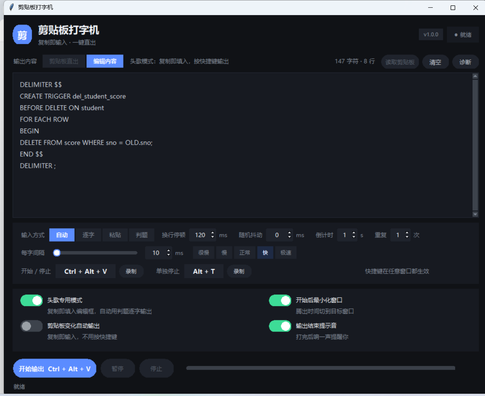

# 剪贴板打字机

一个 Windows 小工具：复制一段文字，按一个快捷键，它就像真人打字一样把内容逐字输出到任意窗口。

适用于网页表单、在线判题平台、远程桌面等「禁止粘贴」或「不方便粘贴」的场景。



## 功能

- **复制即输入**：不用把内容粘贴进工具，复制完直接按快捷键
- **两种内容来源**：编辑内容（可先检查修改）/ 剪贴板直出
- **四种输入方式**：自动 / 逐字 / 粘贴 / 判题
- **在线判题平台适配**：复制即自动填入编辑框，绕开平台禁止粘贴的限制
- **全局快捷键**：在任意窗口都能触发
- 纯 Python 标准库实现，无需安装任何第三方依赖

## 从 GitHub 获取源码

```bash
git clone https://github.com/用户名/仓库名.git
cd 仓库名
```

也可以在仓库页面点击 **Code → Download ZIP**，下载后解压。

## 运行

### 方式一：打包成 exe 后运行（推荐普通用户）

仓库不附带 exe，双击 **`打包exe.bat`** 生成 `dist\ClipboardTyper.exe`，之后双击该文件即可运行。

### 方式二：直接用源码运行

环境要求：Windows + Python 3.8 以上（自带 tkinter，不需要装任何第三方库）

```bash
python clip_typer.py
```

也可以双击 **`启动.bat`**（会优先启动已打包的 exe，没有则用本机 Python 运行）。

## 使用方法

### 基本流程

1. 复制要输入的文字（`Ctrl + C`）
2. 打开工具，确认底部「头歌专用模式」的开关状态符合你的使用场景
3. 把光标点进目标窗口的输入框
4. 按 `Ctrl + Alt + V`，倒计时 1 秒后开始输出

### 快捷键

| 功能 | 默认按键 |
| --- | --- |
| 开始 / 停止输出 | `Ctrl + Alt + V` |
| 单独停止 | `Alt + T` |

想换键时，点界面上的「录制」，按下新的组合键即可。

### 在头歌等在线判题平台使用

1. 打开底部的「头歌专用模式」（默认已开启）
2. 在头歌里选中代码 `Ctrl + C`，内容会自动填进工具的编辑框
3. 光标点进代码编辑区，按 `Ctrl + Alt + V`

该模式会自动禁用「剪贴板直出」——这类平台会拦截粘贴并清空剪贴板，内容已保存在编辑框里，不受影响。

### 常用设置

| 设置 | 说明 |
| --- | --- |
| 每字间隔 | 默认 10ms，数值越小输出越快 |
| 倒计时 | 默认 1 秒，留出切换窗口的时间 |
| 开始后最小化窗口 | 自动把焦点还给目标窗口 |
| 剪贴板变化自动输出 | 复制后直接开始输出，不用按快捷键 |

### 输出不理想时

点右上角 **「诊断」**，可以看到剪贴板状态、当前前台窗口、本次使用的输出策略，并提供：

- **试打**：向目标窗口打一小段测试文字，确认输入通道是否正常
- **判题重试**：一键切换到头歌适配并重新输出
- **恢复默认**：把所有设置还原为默认值
